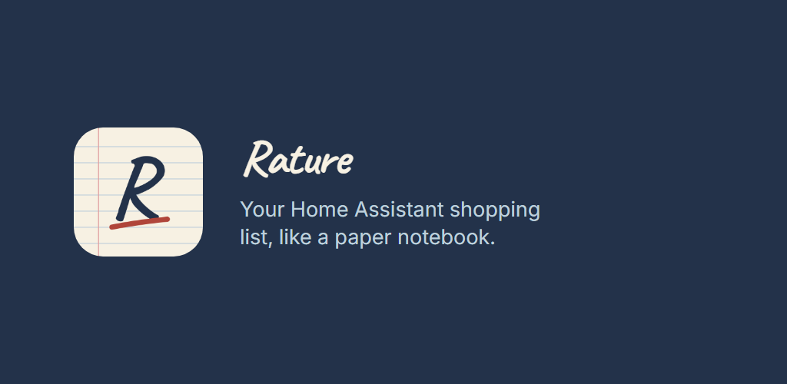
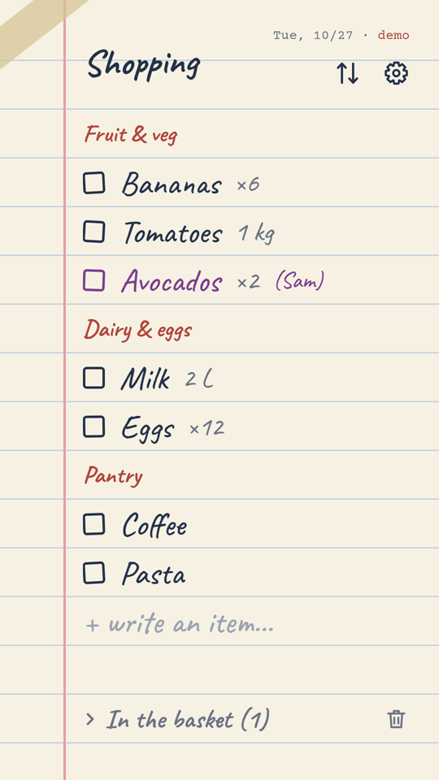
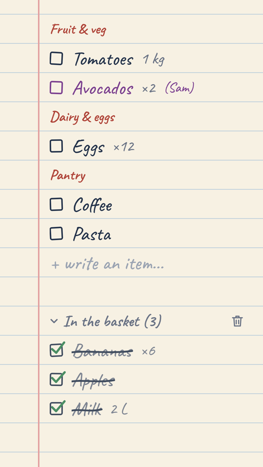
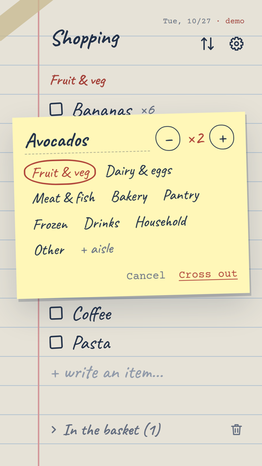

# Rature



Your Home Assistant to-do lists as a lined paper notepad. Android and iPhone.

Rature shows the `todo.*` lists of your Home Assistant, the shopping list first. What gets added by
voice or from another phone shows up live. You tick, cross out, reorder and rename. With no signal,
every change stays on screen and goes out as soon as your home answers.

- **No account and no server of mine:** the app talks directly to your Home Assistant over WebSocket.
- **Your usual login:** you sign in on the regular Home Assistant page, with no token to paste.
- **Free, no ads, no trackers:** three optional tips in the About screen, they unlock nothing.
- **Languages:** English, French and German.

[Get it on Google Play](https://play.google.com/store/apps/details?id=com.danonekid.rature) · [Product page](https://www.codebydk.com/products/rature/) · [Privacy](https://www.codebydk.com/products/rature/privacy/)

<p>
  
  
  
</p>

*Demo mode, with a fictional list.*

Bug or idea? Open an issue. This is a first version, tested mainly on one setup, so your Home
Assistant version and list type help a lot.

## Layout

- `web/`: the interface (Vite, plain JavaScript), built into a single HTML file. Skins live in `web/src/skins/`.
- `app/`: the Flutter shell (full-screen WebView, Home Assistant login, secure token storage, tips).
- `maquettes/`: static mockups of the skin ideas.

## Build

```sh
npm install
npm run dev     # demo mode, fictional list
npm test
npm run app     # builds the interface and copies it to app/assets/app.html
cd app
flutter build apk --debug
```

Run `npm run app` before each Flutter build. Release signing reads `secret/key.properties`, which is
not in this repository.

## Security

Access and refresh tokens stay on your device, in the Keystore or Keychain. To report a vulnerability
privately, write to support@codebydk.com.

## License

Code under the [Apache License 2.0](./LICENSE). The name "Rature", its logo and its icons are not
licensed: if you publish a fork, use your own name and icon.

Fonts: Caveat and Courier Prime (SIL Open Font License 1.1).

Not affiliated with Home Assistant, the Open Home Foundation or Nabu Casa.
